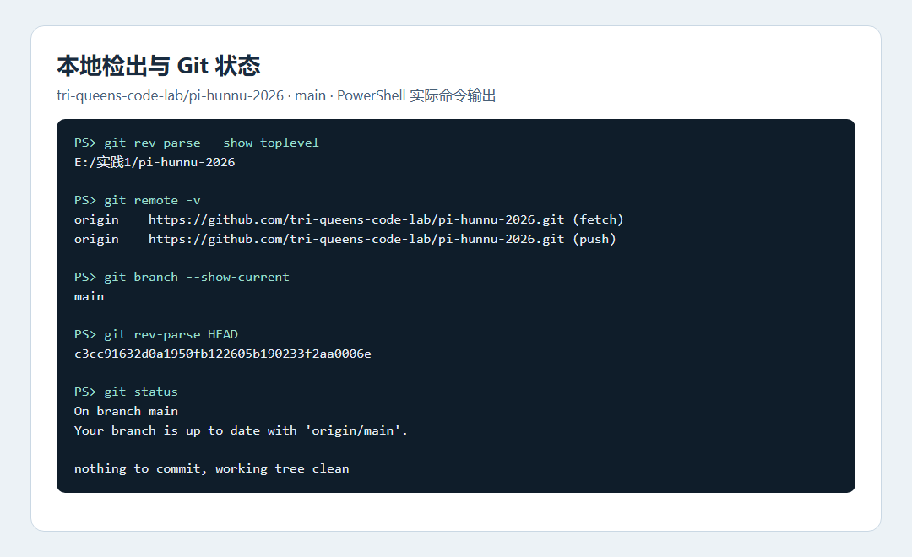
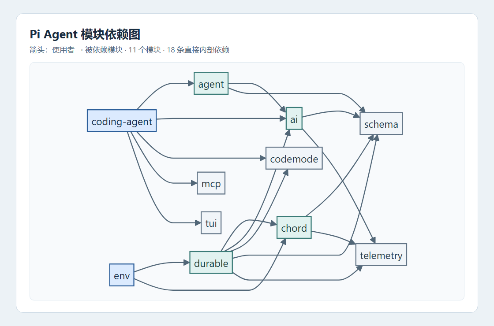
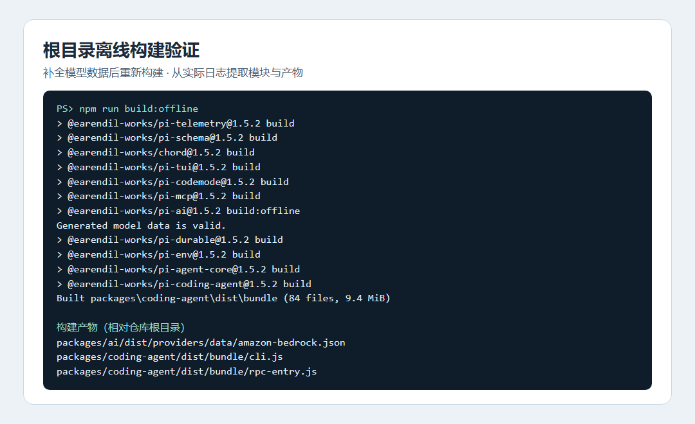

# 实践课2：组织建仓与源码分析

- 姓名：胡嘉豪
- GitHub：`HNNU-OD`
- 实践日期：2026 年 11 月 24 日
- 小组：[tri-queens-code-lab](https://github.com/tri-queens-code-lab)
- 小组源码：[pi-hunnu-2026](https://github.com/tri-queens-code-lab/pi-hunnu-2026)
- 重点复核：`codemode`、`mcp`、`ai`、`durable`

## 一、本地检出与 Git 记录

在 `E:\实践1` 中执行：

```powershell
git clone --branch main --single-branch https://github.com/tri-queens-code-lab/pi-hunnu-2026.git
cd pi-hunnu-2026
git rev-parse --show-toplevel
git remote -v
git branch --show-current
git rev-parse HEAD
git status
```

| 项目 | 实际值 |
| --- | --- |
| 本地路径 | `E:\实践1\pi-hunnu-2026` |
| remote | `origin`，fetch 和 push URL 均为 `https://github.com/tri-queens-code-lab/pi-hunnu-2026.git` |
| 分支 | `main`，跟踪 `origin/main` |
| HEAD | [`c3cc91632d0a1950fb122605b190233f2aa0006e`](https://github.com/tri-queens-code-lab/pi-hunnu-2026/commit/c3cc91632d0a1950fb122605b190233f2aa0006e) |
| `git status` | `Your branch is up to date with 'origin/main'.`；`nothing to commit, working tree clean` |
| 环境 | Windows，Git 2.53.0，Node.js v24.15.0，npm 11.12.1 |

克隆和查阅均使用小组仓库的 `main` 分支。未使用 GitHub 的 `Sync fork`。



图 1 为本机实际 Git 命令输出的渲染截图。

## 二、11 个模块的功能、构建与直接内部依赖

用 11 个子包的 `package.json#name` 将 npm 包名映射到目录名，再从 `dependencies` 提取直接内部依赖，并用 `src/` 中的包导入交叉核对。`@earendil-works/chord` 对应 `chord`，`@earendil-works/pi-agent-core` 对应 `agent`。下表的 `tsc` 均指 `tsc -p tsconfig.build.json`。共享配置为 TypeScript 产物启用声明、声明映射和源码映射。[共享 TypeScript 配置](https://github.com/tri-queens-code-lab/pi-hunnu-2026/blob/c3cc91632d0a1950fb122605b190233f2aa0006e/tsconfig.base.json#L1-L24)

| 模块 | 主要功能 | 构建动作与产物 | 直接内部依赖 | 证据文件 |
| --- | --- | --- | --- | --- |
| `telemetry` | 定义显式传递的 `TelemetryContext`、span 和类型化指标，提供空实现及内存记录实现，可接入不同遥测后端。 | `tsc` → `dist/index.js`、`dist/render.js`、`dist/testing/index.js` 及对应声明和映射。 | 无 | [配置与依赖](https://github.com/tri-queens-code-lab/pi-hunnu-2026/blob/c3cc91632d0a1950fb122605b190233f2aa0006e/packages/telemetry/package.json)、[接口与指标](https://github.com/tri-queens-code-lab/pi-hunnu-2026/blob/c3cc91632d0a1950fb122605b190233f2aa0006e/packages/telemetry/src/index.ts#L95-L130) |
| `schema` | 提供类型化 JSON Schema 构建器、闭包式校验器和可选格式校验，支持 Draft 2020-12 与 Draft 7。 | `tsc` → `dist/index.js`、`dist/formats/index.js` 及对应声明和映射。 | 无 | [配置与依赖](https://github.com/tri-queens-code-lab/pi-hunnu-2026/blob/c3cc91632d0a1950fb122605b190233f2aa0006e/packages/schema/package.json)、[格式与校验](https://github.com/tri-queens-code-lab/pi-hunnu-2026/blob/c3cc91632d0a1950fb122605b190233f2aa0006e/packages/schema/README.md#L1-L12) |
| `chord` | 面向多进程应用的对象运行时。用 Schema 定义对象契约，提供跨进程对象引用、事务文档、观察与插件热重载。 | `tsc` → `dist/index.js` 及 `context`、`sqlite`、`telemetry-ingest` 等子入口和对应声明。 | `schema`、`telemetry` | [配置与依赖](https://github.com/tri-queens-code-lab/pi-hunnu-2026/blob/c3cc91632d0a1950fb122605b190233f2aa0006e/packages/chord/package.json)、[Schema 导入](https://github.com/tri-queens-code-lab/pi-hunnu-2026/blob/c3cc91632d0a1950fb122605b190233f2aa0006e/packages/chord/src/contracts/schema.ts#L21-L23)、[遥测导入](https://github.com/tri-queens-code-lab/pi-hunnu-2026/blob/c3cc91632d0a1950fb122605b190233f2aa0006e/packages/chord/src/telemetry.ts#L15-L23) |
| `tui` | 终端 UI 框架，提供差分渲染、同步输出、键盘与粘贴处理，以及编辑器、列表和 Markdown 等组件。 | `tsc` → `dist/index.js` 和组件模块及声明。平台原生辅助程序由各自 `build:native:*` 脚本单独构建。 | 无 | [配置与依赖](https://github.com/tri-queens-code-lab/pi-hunnu-2026/blob/c3cc91632d0a1950fb122605b190233f2aa0006e/packages/tui/package.json)、[组件入口](https://github.com/tri-queens-code-lab/pi-hunnu-2026/blob/c3cc91632d0a1950fb122605b190233f2aa0006e/packages/tui/src/index.ts#L38-L59) |
| `codemode` | 将模型生成的 JavaScript 放入基于 WebAssembly 的 QuickJS 环境，通过注入的工具桥接能力。提供 Node/Bun worker 和 Cloudflare 入口。 | `tsc` → `dist/index.js`、`dist/portable.js`、`dist/cloudflare.js` 和 `dist/runtime/worker.js` 及对应声明。TypeScript 构建纳入 `src/cloudflare-modules.d.ts`。 | 无 | [配置与依赖](https://github.com/tri-queens-code-lab/pi-hunnu-2026/blob/c3cc91632d0a1950fb122605b190233f2aa0006e/packages/codemode/package.json)、[沙箱入口](https://github.com/tri-queens-code-lab/pi-hunnu-2026/blob/c3cc91632d0a1950fb122605b190233f2aa0006e/packages/codemode/src/index.ts#L11-L18)、[构建配置](https://github.com/tri-queens-code-lab/pi-hunnu-2026/blob/c3cc91632d0a1950fb122605b190233f2aa0006e/packages/codemode/tsconfig.build.json) |
| `mcp` | MCP 客户端，提供传输无关的客户端核心、stdio、管道及 Streamable HTTP 传输、OAuth 和测试传输。 | `tsc` → `dist/index.js`、`dist/oauth/index.js`、`dist/testing/index.js` 及对应声明。 | 无 | [配置与依赖](https://github.com/tri-queens-code-lab/pi-hunnu-2026/blob/c3cc91632d0a1950fb122605b190233f2aa0006e/packages/mcp/package.json)、[客户端与传输入口](https://github.com/tri-queens-code-lab/pi-hunnu-2026/blob/c3cc91632d0a1950fb122605b190233f2aa0006e/packages/mcp/src/index.ts) |
| `ai` | 统一多家 LLM 提供商的模型调用和流式结果，管理模型目录、认证、用量与费用。 | `build` 先生成或刷新模型目录，再转入 `build:offline`。离线脚本先校验现有数据，再 `tsc`，最后清理并复制 provider 数据。输出 `dist/index.js`、`dist/cli.js` 和 `dist/providers/data/` 等。 | `schema`、`telemetry` | [配置与依赖](https://github.com/tri-queens-code-lab/pi-hunnu-2026/blob/c3cc91632d0a1950fb122605b190233f2aa0006e/packages/ai/package.json)、[目录生成](https://github.com/tri-queens-code-lab/pi-hunnu-2026/blob/c3cc91632d0a1950fb122605b190233f2aa0006e/packages/ai/catalog/generate.ts#L170-L246)、[模型 Schema](https://github.com/tri-queens-code-lab/pi-hunnu-2026/blob/c3cc91632d0a1950fb122605b190233f2aa0006e/packages/ai/src/providers/model-schema.ts#L1-L18)、[遥测导入](https://github.com/tri-queens-code-lab/pi-hunnu-2026/blob/c3cc91632d0a1950fb122605b190233f2aa0006e/packages/ai/src/telemetry.ts#L1-L12) |
| `durable` | 持久化 Agent 执行框架，先提交对话、模型轮次和工具结果再对外呈现，支持重启后从存储恢复，使用 Chord 管理文档状态。 | `tsc` → `dist/index.js`、`dist/env/index.js`、存储和工具等子入口及声明。构建配置显式解析 Chord 和 AI 的 `dist/*.d.ts`。 | `chord`、`ai`、`codemode`、`schema`、`telemetry` | [配置与依赖](https://github.com/tri-queens-code-lab/pi-hunnu-2026/blob/c3cc91632d0a1950fb122605b190233f2aa0006e/packages/durable/package.json)、[Chord 文档导入](https://github.com/tri-queens-code-lab/pi-hunnu-2026/blob/c3cc91632d0a1950fb122605b190233f2aa0006e/packages/durable/src/documents.ts#L1-L12)、[模型与工具导入](https://github.com/tri-queens-code-lab/pi-hunnu-2026/blob/c3cc91632d0a1950fb122605b190233f2aa0006e/packages/durable/src/codemode/codemode.ts#L34-L53)、[构建配置](https://github.com/tri-queens-code-lab/pi-hunnu-2026/blob/c3cc91632d0a1950fb122605b190233f2aa0006e/packages/durable/tsconfig.build.json) |
| `env` | 提供 Durable 的远程 `ExecutionEnv`，通过连接与 Rust 守护进程通信，在远端执行命令和文件操作。 | `tsc` → `dist/index.js` 及远程环境模块与声明。独立的 `build:daemon` 使用 Cargo 生成 `daemon/target/debug/pi-env.exe`（Windows 默认调试路径）。 | `chord`、`durable` | [配置与依赖](https://github.com/tri-queens-code-lab/pi-hunnu-2026/blob/c3cc91632d0a1950fb122605b190233f2aa0006e/packages/env/package.json)、[两项依赖的导入](https://github.com/tri-queens-code-lab/pi-hunnu-2026/blob/c3cc91632d0a1950fb122605b190233f2aa0006e/packages/env/src/list-files.ts#L1-L16)、[Rust 目标](https://github.com/tri-queens-code-lab/pi-hunnu-2026/blob/c3cc91632d0a1950fb122605b190233f2aa0006e/packages/env/daemon/Cargo.toml#L1-L7) |
| `agent` | `@earendil-works/pi-agent-core`，维护 Agent 状态及消息队列，协调模型流、工具调用和事件发布。 | `tsc` → `dist/index.js`、`dist/agent.js`、`dist/agent-loop.js` 及对应声明。 | `ai`、`schema` | [配置与依赖](https://github.com/tri-queens-code-lab/pi-hunnu-2026/blob/c3cc91632d0a1950fb122605b190233f2aa0006e/packages/agent/package.json)、[模型调用](https://github.com/tri-queens-code-lab/pi-hunnu-2026/blob/c3cc91632d0a1950fb122605b190233f2aa0006e/packages/agent/src/agent-loop.ts#L1-L24)、[工具参数类型](https://github.com/tri-queens-code-lab/pi-hunnu-2026/blob/c3cc91632d0a1950fb122605b190233f2aa0006e/packages/agent/src/types.ts#L12-L20) |
| `coding-agent` | 面向开发者的 Pi CLI 和 SDK，组织会话、扩展、MCP、工具、交互界面及 RPC 模式。 | 先 `build:unbundled`（`tsc`、标记 CLI/RPC 入口为可执行、复制主题/图片/HTML 导出资源），再用 esbuild 生成 `dist/bundle/`，包括 `cli.js`、`rpc-entry.js` 和相关 chunks/worker。Bun 独立二进制走单独的 `build:binary`。 | `agent`、`ai`、`codemode`、`mcp`、`tui` | [配置与依赖](https://github.com/tri-queens-code-lab/pi-hunnu-2026/blob/c3cc91632d0a1950fb122605b190233f2aa0006e/packages/coding-agent/package.json)、[Agent 会话](https://github.com/tri-queens-code-lab/pi-hunnu-2026/blob/c3cc91632d0a1950fb122605b190233f2aa0006e/packages/coding-agent/src/core/agent-session.ts#L25-L45)、[MCP 接入](https://github.com/tri-queens-code-lab/pi-hunnu-2026/blob/c3cc91632d0a1950fb122605b190233f2aa0006e/packages/coding-agent/src/core/mcp-servers.ts#L1-L20)、[esbuild 脚本](https://github.com/tri-queens-code-lab/pi-hunnu-2026/blob/c3cc91632d0a1950fb122605b190233f2aa0006e/scripts/build-coding-agent-bundle.mjs#L154-L177) |

补充范围：`packages/evals` 也匹配 workspace 通配符，但没有 `build` 脚本。 `apps/` 下的应用有自己的配置，根 `build` 的命令链只进入上表 11 个包。[evals/package.json](https://github.com/tri-queens-code-lab/pi-hunnu-2026/blob/c3cc91632d0a1950fb122605b190233f2aa0006e/packages/evals/package.json)、[根构建命令](https://github.com/tri-queens-code-lab/pi-hunnu-2026/blob/c3cc91632d0a1950fb122605b190233f2aa0006e/package.json#L5-L19)

## 三、模块依赖图

读法为 **使用者 → 被依赖模块**。例如 `env → chord` 是直接依赖，同时还有经由 `durable` 的间接路径。图中共有 **11 个节点、18 条直接依赖边**。颜色仅用于辅助阅读。



[可编辑 Mermaid 源文件](dependency-graph.mmd)

## 四、三个问题

### 1. 根目录和子模块如何配置构建？

根 `package.json` 是私有 npm monorepo 的入口，用 `workspaces` 注册 `packages/*`、`apps/*` 及几个显式列出的示例包，根 `package-lock.json` 锁定依赖。根 `build` 和 `build:offline` 逐包执行脚本，顺序如下。

```text
telemetry, schema, chord, tui, codemode, mcp, ai, durable, env, agent, coding-agent
```

两个脚本的区别在 `ai`：普通构建先生成模型目录，离线构建直接校验现有数据并编译。每个包在自己的 `package.json` 定义动作，其 `tsconfig.build.json` 继承根 `tsconfig.base.json`，以 `src/` 为来源、以 `dist/` 为输出。根 `tsconfig.json` 用 `noEmit` 和指向源码的 `paths` 做仓库级检查。各包的产物构建读取自己的配置，例如 `agent` 将 AI 包映射到 `../ai/dist/index.d.ts`。[根 package.json](https://github.com/tri-queens-code-lab/pi-hunnu-2026/blob/c3cc91632d0a1950fb122605b190233f2aa0006e/package.json#L1-L19)、[根 tsconfig.json](https://github.com/tri-queens-code-lab/pi-hunnu-2026/blob/c3cc91632d0a1950fb122605b190233f2aa0006e/tsconfig.json#L1-L9)、[agent 构建配置](https://github.com/tri-queens-code-lab/pi-hunnu-2026/blob/c3cc91632d0a1950fb122605b190233f2aa0006e/packages/agent/tsconfig.build.json#L1-L12)、[CI 安装与构建](https://github.com/tri-queens-code-lab/pi-hunnu-2026/blob/c3cc91632d0a1950fb122605b190233f2aa0006e/\.github/workflows/ci.yml#L17-L33)

### 2. 构建顺序和依赖关系有什么区别？

构建顺序是根脚本选定的串行执行次序，`&&` 使前一步失败后停止。依赖关系说明谁使用谁，所以图上的 `agent → ai` 表示 Agent 使用 AI，而脚本要让 `ai` 先于 `agent` 构建，以便读到 AI 的声明。排在相邻位置也无法推出依赖，例如 `tui` 紧接在 `chord` 后构建，但二者没有直接依赖。根据源码清单逐条检查，18 条边的被依赖包均出现在使用者之前。[根脚本](https://github.com/tri-queens-code-lab/pi-hunnu-2026/blob/c3cc91632d0a1950fb122605b190233f2aa0006e/package.json#L14-L19)、[TUI 包配置](https://github.com/tri-queens-code-lab/pi-hunnu-2026/blob/c3cc91632d0a1950fb122605b190233f2aa0006e/packages/tui/package.json)、[agent 构建配置](https://github.com/tri-queens-code-lab/pi-hunnu-2026/blob/c3cc91632d0a1950fb122605b190233f2aa0006e/packages/agent/tsconfig.build.json#L1-L12)

### 3. 一条至少跨 3 个模块的依赖路径是什么？

**`coding-agent → agent → ai → schema`** 跨 4 个模块。Coding Agent 的会话层使用 Agent 核心。Agent 核心通过 AI 包调用模型并接收流式结果。AI 的 provider 模型配置使用 Schema 包定义和校验结构。每一步均能在对应包的直接依赖和导入处查到。[coding-agent 会话](https://github.com/tri-queens-code-lab/pi-hunnu-2026/blob/c3cc91632d0a1950fb122605b190233f2aa0006e/packages/coding-agent/src/core/agent-session.ts#L25-L45)、[Agent 循环](https://github.com/tri-queens-code-lab/pi-hunnu-2026/blob/c3cc91632d0a1950fb122605b190233f2aa0006e/packages/agent/src/agent-loop.ts#L1-L24)、[AI 模型 Schema](https://github.com/tri-queens-code-lab/pi-hunnu-2026/blob/c3cc91632d0a1950fb122605b190233f2aa0006e/packages/ai/src/providers/model-schema.ts#L1-L18)

另一条经过本次重点模块的路径是 `env → durable → chord → schema`。Env 实现 Durable 的远程执行接口，Durable 使用 Chord 文档，Chord 用 Schema 描述对象契约。[Env 导入](https://github.com/tri-queens-code-lab/pi-hunnu-2026/blob/c3cc91632d0a1950fb122605b190233f2aa0006e/packages/env/src/list-files.ts#L1-L16)、[Durable 文档](https://github.com/tri-queens-code-lab/pi-hunnu-2026/blob/c3cc91632d0a1950fb122605b190233f2aa0006e/packages/durable/src/documents.ts#L1-L12)、[Chord 对象契约](https://github.com/tri-queens-code-lab/pi-hunnu-2026/blob/c3cc91632d0a1950fb122605b190233f2aa0006e/packages/chord/src/contracts/schema.ts#L21-L23)

## 五、构建验证

在小组仓库根目录安装锁文件依赖并运行离线构建。第一次运行时，前六个包成功编译，流程在 `ai` 的 `check:model-data` 步骤停止。错误为 `ENOENT`，缺少 `packages/ai/src/providers/data/amazon-bedrock.json`。按仓库脚本的提示补全模型数据后，第二次离线构建成功，退出码为 `0`。

```powershell
npm ci --ignore-scripts --no-audit --no-fund
npm run build:offline
npm run hydrate:model-data
npm run build:offline
```

本次复核了 11 个包的 `dist/index.js` 和 `dist/index.d.ts`，以及 AI 的 provider 数据和 `coding-agent` 的 CLI、RPC bundle。esbuild 报告生成了 84 个文件，总计 9.4 MiB。构建完成后，`git status` 仍显示工作区干净。Rust 守护进程、TUI 原生辅助程序和 Bun 独立二进制为单独的构建入口，本次验证范围是根目录的离线构建。 [模型数据检查脚本](https://github.com/tri-queens-code-lab/pi-hunnu-2026/blob/c3cc91632d0a1950fb122605b190233f2aa0006e/packages/ai/scripts/check-model-data.ts)


