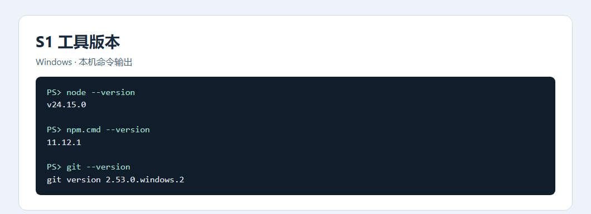
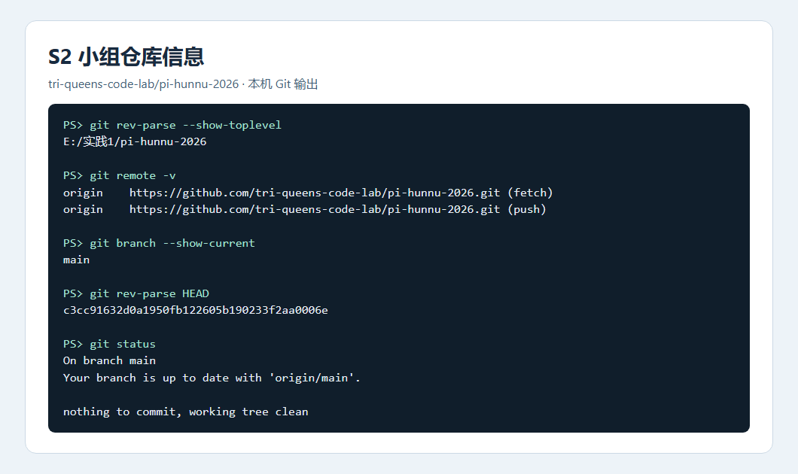
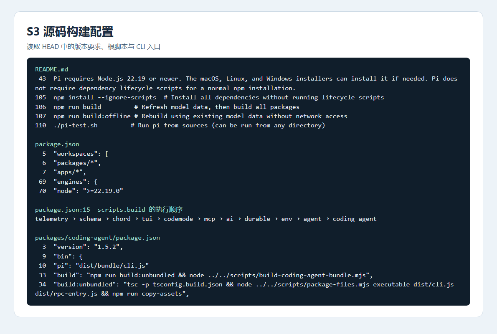
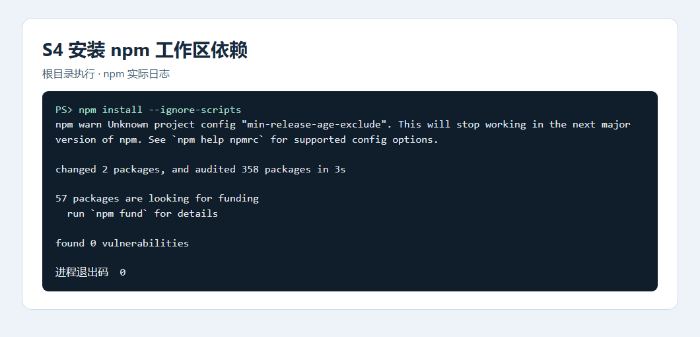
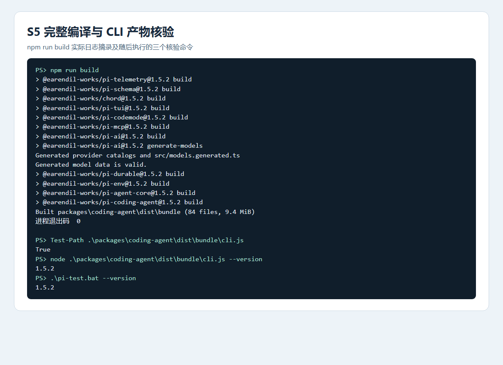
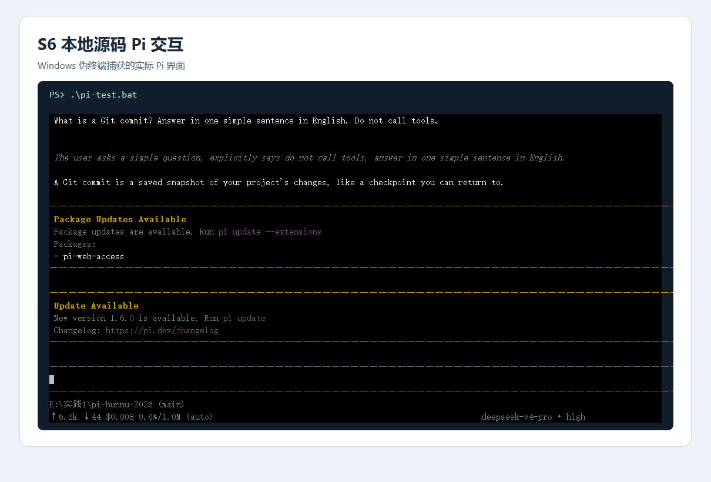

# 实践课3：Pi Agent源码安装与编译

| 项目 | 信息 |
| --- | --- |
| 姓名 | 胡嘉豪 |
| 学号 | 202430224010 |
| GitHub | `HNNU-OD` |
| 实践日期 | 2026 年 11 月 24 日 |
| 平台 | Windows / PowerShell |

## S1 工具版本

运行 `node --version`、`npm.cmd --version`、`git --version`，得到 Node.js `v24.15.0`、npm `11.12.1`、Git `2.53.0.windows.2`。Node.js 版本满足仓库要求的 `>=22.19.0`。



## S2 小组仓库

复用实践课 2 已经克隆的小组仓库，从仓库根目录安装、编译和启动。

| 项目 | 实际值 |
| --- | --- |
| 本地路径 | `E:\实践1\pi-hunnu-2026` |
| 远端 | `origin`，fetch 与 push 均指向 `https://github.com/tri-queens-code-lab/pi-hunnu-2026.git` |
| 分支 | `main`，跟踪 `origin/main` |
| HEAD | [`c3cc91632d0a1950fb122605b190233f2aa0006e`](https://github.com/tri-queens-code-lab/pi-hunnu-2026/commit/c3cc91632d0a1950fb122605b190233f2aa0006e) |
| 工作区 | `git status` 显示干净 |



## S3 阅读构建配置

| 文件 | 查到的配置 |
| --- | --- |
| [根目录 README.md](https://github.com/tri-queens-code-lab/pi-hunnu-2026/blob/c3cc91632d0a1950fb122605b190233f2aa0006e/README.md#L100-L111) | `Development` 小节给出 `npm install --ignore-scripts`、`npm run build` 和源码启动方式。普通构建会刷新模型数据，离线构建复用现有数据。 |
| [根目录 package.json](https://github.com/tri-queens-code-lab/pi-hunnu-2026/blob/c3cc91632d0a1950fb122605b190233f2aa0006e/package.json#L1-L20) | npm workspaces 纳管 `packages/*`、`apps/*` 和指定示例。根 `build` 从 `telemetry` 开始串行构建 11 个包，最后构建 `coding-agent`。 |
| [packages/coding-agent/package.json](https://github.com/tri-queens-code-lab/pi-hunnu-2026/blob/c3cc91632d0a1950fb122605b190233f2aa0006e/packages/coding-agent/package.json#L1-L36) | `build:unbundled` 执行 TypeScript 编译、设置 CLI/RPC 入口和复制资源。`build` 随后调用 esbuild 打包脚本，`bin.pi` 指向 `dist/bundle/cli.js`。包版本为 `1.5.2`。 |



## S4 安装依赖

在仓库根目录执行以下命令。`--ignore-scripts` 禁用安装阶段的依赖生命周期脚本。

```powershell
npm install --ignore-scripts
```

npm 实际报告更新了 2 个包，审计了 358 个包，退出码为 `0`。日志中的 `min-release-age-exclude` 提示来自 npm 对项目配置项的识别，安装继续执行成功。



## S5 完整编译与产物核验

```powershell
npm run build
Test-Path .\packages\coding-agent\dist\bundle\cli.js
node .\packages\coding-agent\dist\bundle\cli.js --version
.\pi-test.bat --version
```

首次构建长时间停在 `Fetching models.dev catalog...`。诊断时，直连下载未在设定时间内完成，通过本机已有代理可以正常访问。停止首次构建后，仅为重试进程设置 `HTTP_PROXY`、`HTTPS_PROXY` 和 `NODE_USE_ENV_PROXY=1`，再执行同一条 `npm run build`。重试成功刷新了模型目录、串行编译了 11 个包并完成 CLI 打包。esbuild 报告生成 84 个文件，共 9.4 MiB，构建退出码为 `0`。安装和构建完成后，Git 工作区仍干净。

| 核验命令 | 实际输出 |
| --- | --- |
| `Test-Path .\packages\coding-agent\dist\bundle\cli.js` | `True` |
| `node .\packages\coding-agent\dist\bundle\cli.js --version` | `1.5.2` |
| `.\pi-test.bat --version` | `1.5.2` |

前一个版本命令验证编译后的 bundle 入口。后一个命令经由 `pi-test.ps1` 加载源码解析器并启动 `packages/coding-agent/src/cli.ts`，验证本地源码入口。[Windows 启动脚本](https://github.com/tri-queens-code-lab/pi-hunnu-2026/blob/c3cc91632d0a1950fb122605b190233f2aa0006e/pi-test.ps1)



## S6 本地源码交互

```powershell
.\pi-test.bat
```

启动时选择 `Do not trust (this session only)`，只用单次会话完成问答，避免为这次实验加载项目扩展。Pi 使用本机已有配置中的 `deepseek-v4-pro`。

我输入了 `What is a Git commit? Answer in one simple sentence in English. Do not call tools.`

Pi 的回答如下。

> A Git commit is a saved snapshot of your project's changes, like a checkpoint you can return to.



S1、S2、S4 和 S5 由本机实际输出渲染，S3 提取自本次分析提交。S6 由 Windows 伪终端捕获实际 Pi TUI 画面。个人仓库提交内容为本报告和六张截图。
