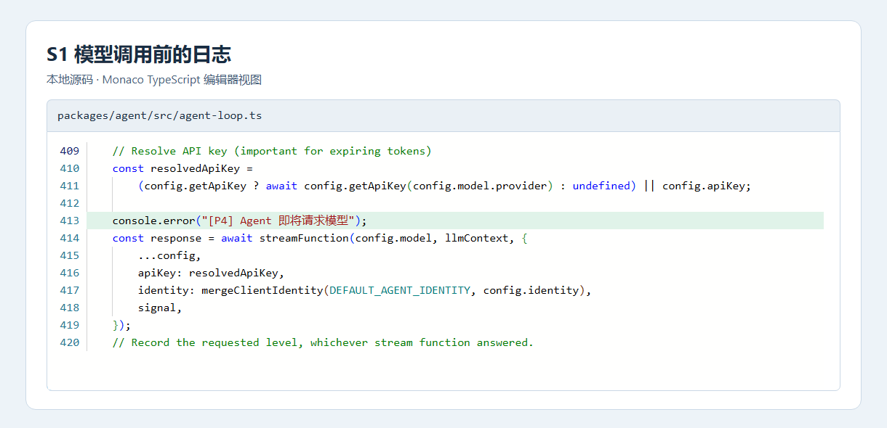
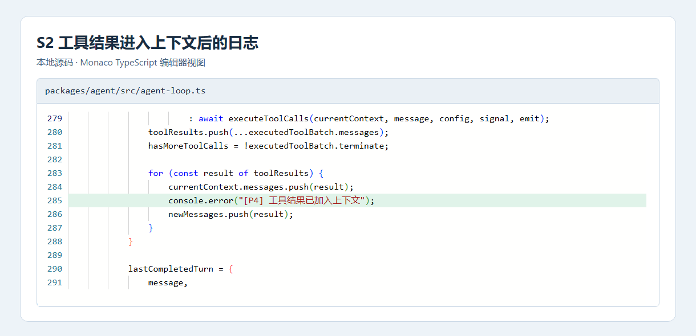
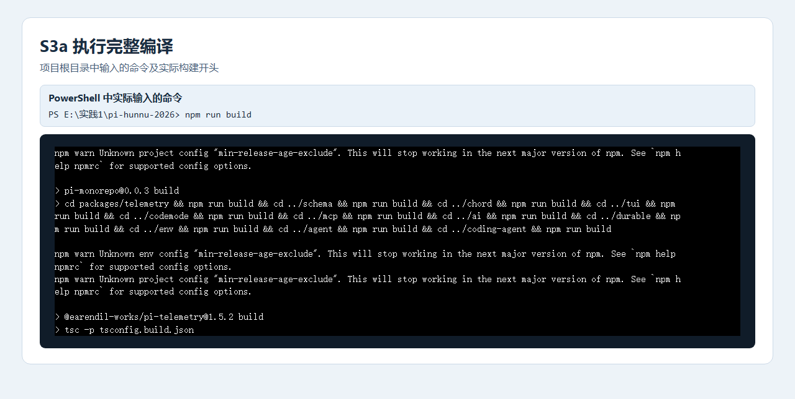
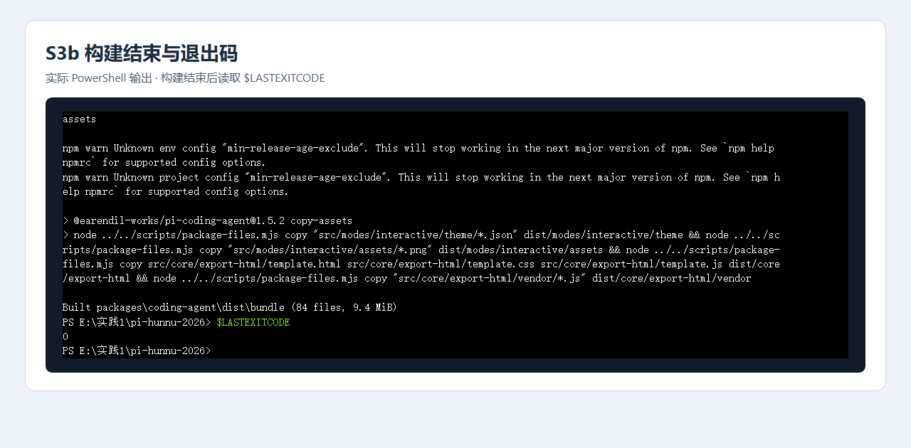
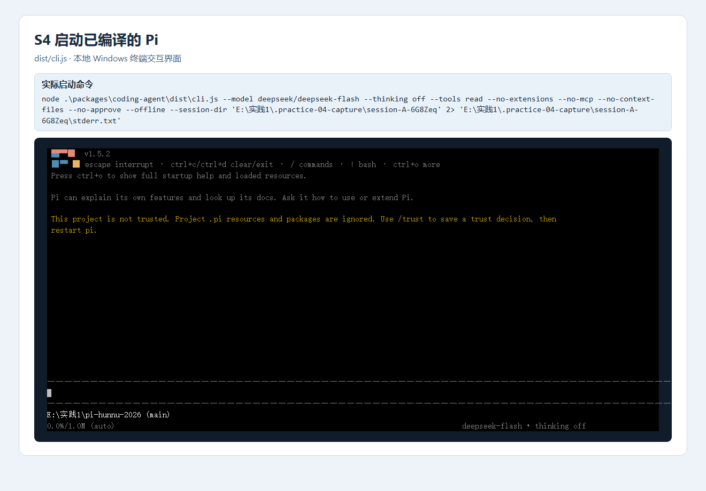
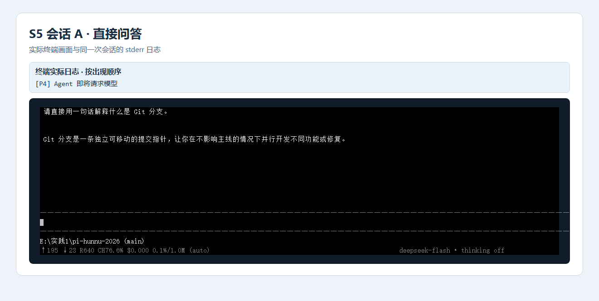
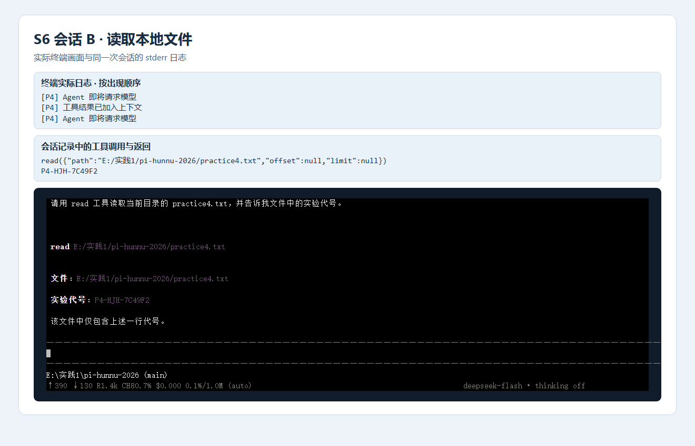
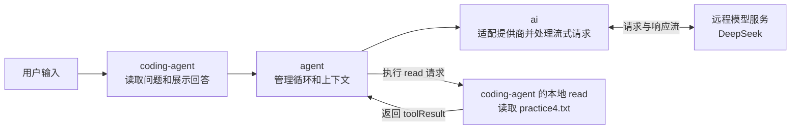

# 实践课4：Pi Agent模型调用与运行流程

| 项目 | 内容 |
| --- | --- |
| 姓名 | 胡嘉豪 |
| 学号 | 202430224010 |
| GitHub | `HNNU-OD` |
| 日期 | 2026 年 11 月 26 日 |
| 小组源码 | [`tri-queens-code-lab/pi-hunnu-2026` 的 `main`](https://github.com/tri-queens-code-lab/pi-hunnu-2026/tree/main) |
| 基础提交 | [`c3cc91632d0a1950fb122605b190233f2aa0006e`](https://github.com/tri-queens-code-lab/pi-hunnu-2026/commit/c3cc91632d0a1950fb122605b190233f2aa0006e) |
| 本地仓库 | `E:\实践1\pi-hunnu-2026` |
| Pi 与模型 | Pi `1.5.2` · `deepseek/deepseek-flash` · 思考级别 `off` |

## 一、给 Agent 循环加两条日志

在 `packages/agent/src/agent-loop.ts` 中添加两条 `console.error`。本报告的行号按两处修改后的文件计算。

| 编号 | 新增行 | 插入位置 | 观察点 |
| --- | ---: | --- | --- |
| S1 | 413 | `await streamFunction(...)` 前一行 | 每次到达模型调用位置时打印 `[P4] Agent 即将请求模型`。 |
| S2 | 285 | `for (const result of toolResults)` 循环内，紧跟 `currentContext.messages.push(result)` | 每追加一条工具结果时打印 `[P4] 工具结果已加入上下文`。 |

[两行源码差异](agent-loop.patch)





## 二、完整构建并启动编译产物

在带有根 `package.json` 的目录执行以下命令。本次运行复用了实践三已经安装的依赖，通过本机现有代理刷新模型目录。

```powershell
npm run build
$LASTEXITCODE
```

构建结束后回到 PowerShell 提示符，`$LASTEXITCODE` 返回 `0`，随后用 `node .\packages\coding-agent\dist\cli.js` 启动 Pi `1.5.2`。两次会话先选定同一个 `deepseek-flash` 模型，使用不同的会话目录，都只开放本地 `read` 工具。运行时将 stderr 写入独立的本地记录文件，便于按出现顺序核对 `[P4]` 日志。







额外执行 `npm run check` 时，格式检查通过，随后 TypeScript 在 `packages/ai/test/` 中报了模型 ID 类型错误。因此，本报告以成功的完整构建和两个实测会话作为运行验收依据。

## 三、两次新会话的实际记录

在仓库根目录创建 `practice4.txt`，文件中只有一行代号。会话 B 的输入只包含文件名。

### 会话 A · 直接问答

> 请直接用一句话解释什么是 Git 分支。

工具调用为 **0 次**，模型调用为 **1 轮**。

```text
[P4] Agent 即将请求模型
```

Pi 的最终回复如下。

> Git 分支是一条独立可移动的提交指针，让你在不影响主线的情况下并行开发不同功能或修复。



### 会话 B · 读取文件

> 请用 `read` 工具读取当前目录的 `practice4.txt`，并告诉我文件中的实验代号。

本机 `read` 工具执行 **1 次**，读取 `E:/实践1/pi-hunnu-2026/practice4.txt` 并返回 `P4-HJH-7C49F2`。模型调用为 **2 轮**。

```text
[P4] Agent 即将请求模型
[P4] 工具结果已加入上下文
[P4] Agent 即将请求模型
```

Pi 的最终回复如下。

> **文件**：`E:/实践1/pi-hunnu-2026/practice4.txt`
>
> **实验代号**：`P4-HJH-7C49F2`
>
> 该文件中仅包含上述一行代号。



## 四、模型调用与工具结果回填

会话 A 的第一轮流式响应直接给出了最终文本，Agent 随即结束本次运行。会话 B 的第一轮响应提出了 `read` 调用，`coding-agent` 注册的本地工具读取了磁盘文件。`agent` 将这一调用的返回内容封装为 `toolResult`，写入 `currentContext.messages`。下一轮交给 `ai` 的上下文保留了原问题，新增了上一轮助手的 `read` 调用，以及对应的工具结果和代号。远程 DeepSeek 根据回填进上下文的代号生成最终回答。 [本地 read 实现](https://github.com/tri-queens-code-lab/pi-hunnu-2026/blob/c3cc91632d0a1950fb122605b190233f2aa0006e/packages/coding-agent/src/core/tools/read.ts) · [Agent 循环原始实现](https://github.com/tri-queens-code-lab/pi-hunnu-2026/blob/c3cc91632d0a1950fb122605b190233f2aa0006e/packages/agent/src/agent-loop.ts)



S1–S2 使用本机源码的 Monaco 编辑器视图。S3–S6 的画面来自 Windows 伪终端，S5–S6 将同一次运行的真实 stderr 日志和 Pi 终端画面呈现在同一张图中。 [课程讲义](https://github.com/hunnuOpenSourceSoftware2026/assignments/blob/main/practice/04-Pi-Agent-run.md)
