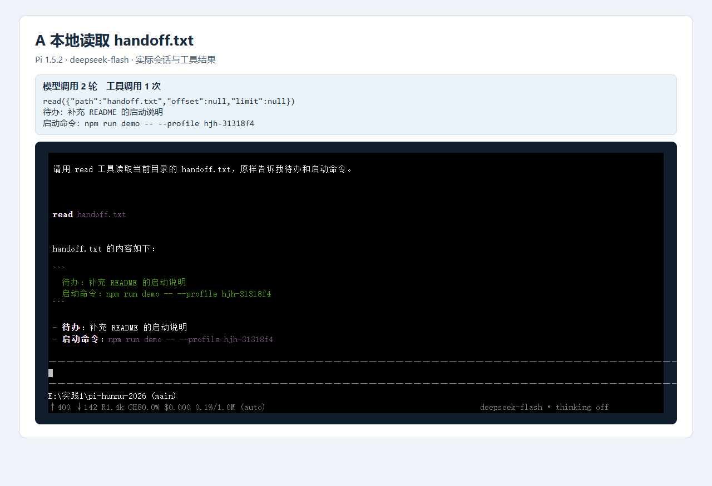
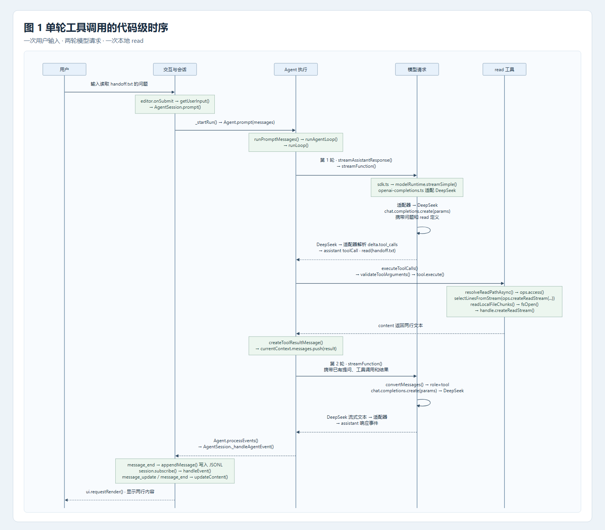
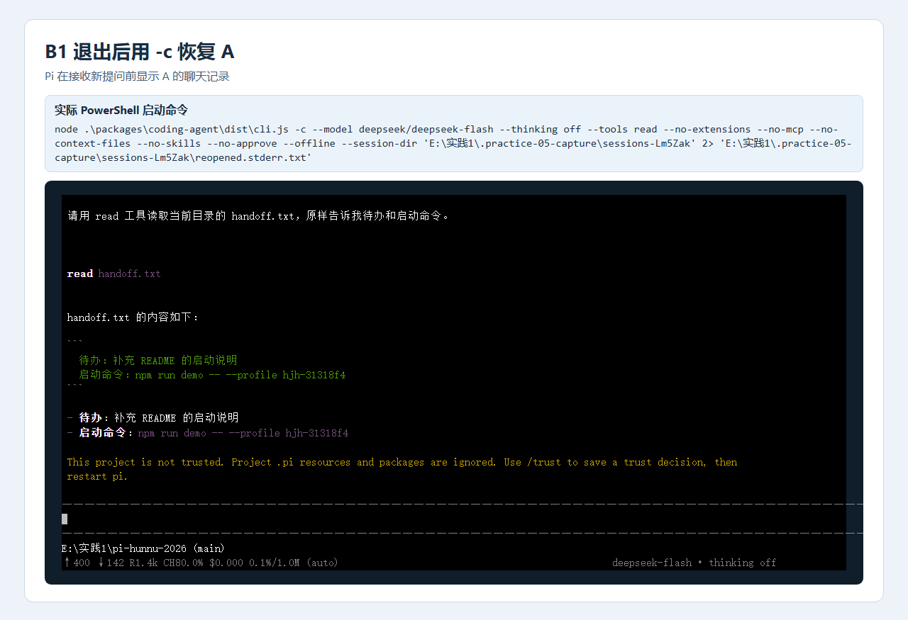
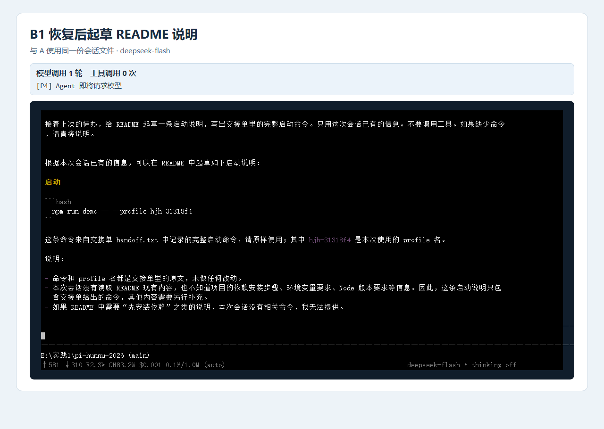
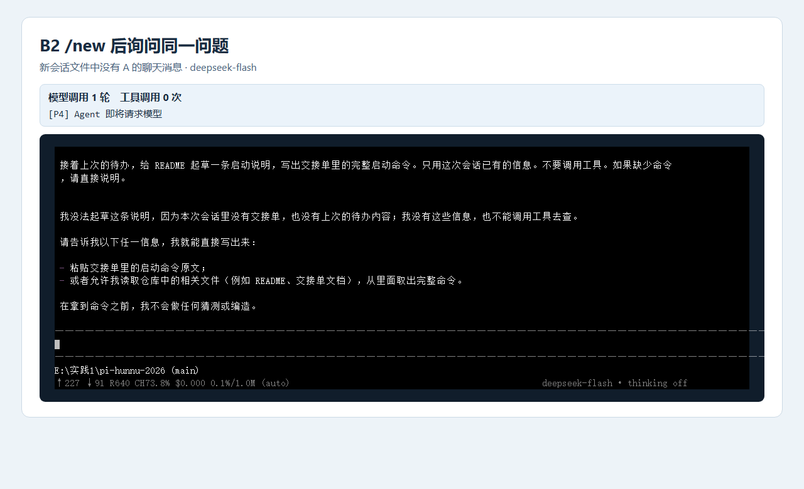
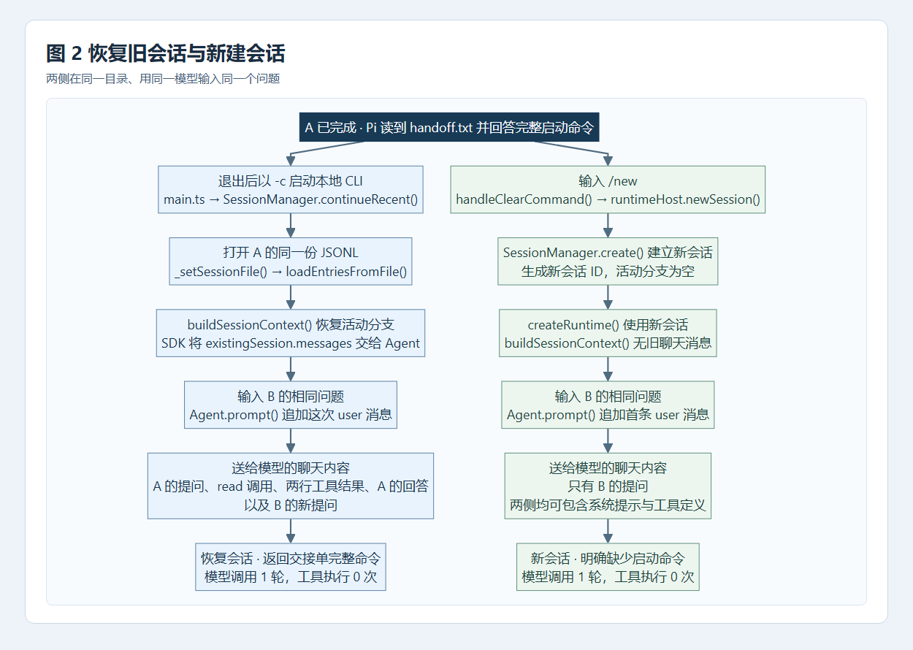

# 实践 05｜Pi Agent 工具调用与会话恢复

| 项目 | 内容 |
| --- | --- |
| 姓名 | 胡嘉豪 |
| 学号 | 202430224010 |
| GitHub | `HNNU-OD` |
| 日期 | 2026 年 11 月 26 日 |
| 小组源码 | [`tri-queens-code-lab/pi-hunnu-2026` 的 `main`](https://github.com/tri-queens-code-lab/pi-hunnu-2026/tree/main) |
| 基础提交 | [`c3cc91632d0a1950fb122605b190233f2aa0006e`](https://github.com/tri-queens-code-lab/pi-hunnu-2026/commit/c3cc91632d0a1950fb122605b190233f2aa0006e) |
| 本地仓库 | `E:\实践1\pi-hunnu-2026` |
| 实验环境 | Windows PowerShell，Pi `1.5.2`，`deepseek/deepseek-flash`，思考级别 `off` |

## A．一次输入与本地工具调用

复用实践 04 编译好的 `packages/coding-agent/dist/cli.js` 和两条 `[P4]` 日志。在项目根目录新建 `handoff.txt`，随机生成本次 profile 标识。文件实际内容如下。

```text
待办：补充 README 的启动说明
启动命令：npm run demo -- --profile hjh-31318f4
```

在新会话中输入以下问题。启动命令和标识都留在文件里。

> 请用 read 工具读取当前目录的 handoff.txt，原样告诉我待办和启动命令。

本次只有 **1 次用户输入**。会话记录显示模型调用 **2 轮**，`read` 执行 **1 次**。模型第一轮生成 `read` 调用，本地工具返回两行文本，第二轮回答。

```text
[P4] Agent 即将请求模型
[P4] 工具结果已加入上下文
[P4] Agent 即将请求模型
```

Pi 的实际回复如下。

> handoff.txt 的内容如下：
>
> ```
> 待办：补充 README 的启动说明
> 启动命令：npm run demo -- --profile hjh-31318f4
> ```
>
> - **待办**：补充 README 的启动说明
> - **启动命令**：`npm run demo -- --profile hjh-31318f4`



### 图 1．单轮工具调用的代码级时序



[可编辑 Mermaid 源文件](figures/figure-1.mmd)

1. 终端编辑器的 `onSubmit` 将文字交给 `getUserInput()`，主交互循环调用 `AgentSession.prompt()`。会话准备好本轮消息后，`_startRun()` 调用 `Agent.prompt()`，经 `runPromptMessages()` 进入 `runAgentLoop()`。 [交互输入](https://github.com/tri-queens-code-lab/pi-hunnu-2026/blob/c3cc91632d0a1950fb122605b190233f2aa0006e/packages/coding-agent/src/modes/interactive/interactive-mode.ts#L1292-L1305) · [会话启动](https://github.com/tri-queens-code-lab/pi-hunnu-2026/blob/c3cc91632d0a1950fb122605b190233f2aa0006e/packages/coding-agent/src/core/agent-session.ts#L1960-L1986) · [Agent.prompt](https://github.com/tri-queens-code-lab/pi-hunnu-2026/blob/c3cc91632d0a1950fb122605b190233f2aa0006e/packages/agent/src/agent.ts#L379-L455)
2. `streamAssistantResponse()` 将活动上下文转换并规范化后交给 `streamFunction()`。本地 SDK 的流函数调用 `modelRuntime.streamSimple()`，DeepSeek 走 `openai-completions` 适配器。`client.chat.completions.create()` 发请求，第一轮从返回流解析 `delta.tool_calls`。 [SDK 流函数](https://github.com/tri-queens-code-lab/pi-hunnu-2026/blob/c3cc91632d0a1950fb122605b190233f2aa0006e/packages/coding-agent/src/core/sdk.ts#L401-L423) · [DeepSeek provider](https://github.com/tri-queens-code-lab/pi-hunnu-2026/blob/c3cc91632d0a1950fb122605b190233f2aa0006e/packages/ai/src/providers/deepseek.ts) · [模型请求](https://github.com/tri-queens-code-lab/pi-hunnu-2026/blob/c3cc91632d0a1950fb122605b190233f2aa0006e/packages/ai/src/api/openai-completions.ts#L365-L389)
3. 本次记录的 `read` 参数为 `{"path":"handoff.txt","offset":null,"limit":null}`。在同一构建产物中用 `validateToolArguments()` 重放这组参数，实际得到 `{"path":"handoff.txt"}`，两个可选范围字段为 `undefined`。因此本地默认 `read` 的文本分支满足 `isStreamableRange()`，走 `selectLinesFromStream(ops.createReadStream(...))`。默认 `createReadStream` 绑定 `readLocalFileChunks()`，底层是 `fsOpen()` 打开本地文件，再由 `handle.createReadStream()` 读分块。 [参数校验](https://github.com/tri-queens-code-lab/pi-hunnu-2026/blob/c3cc91632d0a1950fb122605b190233f2aa0006e/packages/ai/src/utils/validation.ts#L44-L72) · [默认读取实现](https://github.com/tri-queens-code-lab/pi-hunnu-2026/blob/c3cc91632d0a1950fb122605b190233f2aa0006e/packages/coding-agent/src/core/tools/read.ts#L67-L93) · [文本分支](https://github.com/tri-queens-code-lab/pi-hunnu-2026/blob/c3cc91632d0a1950fb122605b190233f2aa0006e/packages/coding-agent/src/core/tools/read.ts#L294-L309)
4. `createToolResultMessage()` 把文本包装为 `toolResult`，`runLoop()` 通过 `currentContext.messages.push(result)` 加入上下文。适配器第二轮把该结果转换成带有匹配 `tool_call_id` 的 `role: "tool"` 消息。回复流经 Agent 事件和会话订阅回到终端，`message_update` 更新显示，`message_end` 完成回复并触发会话记录持久化。 [Agent 循环](https://github.com/tri-queens-code-lab/pi-hunnu-2026/blob/c3cc91632d0a1950fb122605b190233f2aa0006e/packages/agent/src/agent-loop.ts#L260-L291) · [工具消息转换](https://github.com/tri-queens-code-lab/pi-hunnu-2026/blob/c3cc91632d0a1950fb122605b190233f2aa0006e/packages/ai/src/api/openai-completions.ts#L1400-L1426) · [会话记录](https://github.com/tri-queens-code-lab/pi-hunnu-2026/blob/c3cc91632d0a1950fb122605b190233f2aa0006e/packages/coding-agent/src/core/agent-session.ts#L1210-L1248) · [终端重绘](https://github.com/tri-queens-code-lab/pi-hunnu-2026/blob/c3cc91632d0a1950fb122605b190233f2aa0006e/packages/coding-agent/src/modes/interactive/interactive-mode.ts#L3649-L3702)

## B．同一问题在恢复会话与新会话中的对照

A 完成后用 `/quit` 退出。仍在同一个项目目录，给本地启动命令增加 `-c`，保留与 A 相同的模型、参数和实验用 `--session-dir`。启动时已能看到 A 的原问题、`read` 记录和含完整命令的回复。随后在该会话里提问。收到回复后，在同一个 Pi 进程中输入 `/new`，再发一遍完全相同的问题。



> 接着上次的待办，给 README 起草一条启动说明，写出交接单里的完整启动命令。只用这次会话已有的信息。不要调用工具。如果缺少命令，请直接说明。

| 对照 | 提问前的聊天记录 | 模型调用 | 工具调用 | 实际结果 |
| --- | --- | ---: | ---: | --- |
| B1 · `-c` 恢复 | 与 A 使用同一 JSONL。已有 A 的提问、助手工具调用、`toolResult` 和 A 的回答。 | 1 轮 | 0 次 | 返回完整启动命令 `npm run demo -- --profile hjh-31318f4`。 |
| B2 · `/new` | 新的 JSONL。B 是首条用户消息。 | 1 轮 | 0 次 | 说明会话缺少交接单和启动命令。 |

两组都记录到一次 `[P4] Agent 即将请求模型`。恢复分支在没有重新读文件的情况下准确复述了随机 profile，新会话在同一工作目录、同一模型、同一提问下缺少该信息。这个对照支持恢复分支使用了已恢复的聊天历史。

### B1．恢复会话的实际回复

> 根据本次会话已有的信息，可以在 README 中起草如下启动说明：
>
> ## 启动
>
> ```bash
> npm run demo -- --profile hjh-31318f4
> ```
>
> 这条命令来自交接单 handoff.txt 中记录的完整启动命令，请原样使用；其中 `hjh-31318f4` 是本次使用的 profile 名。
>
> 说明：
>
> - 命令和 profile 名都是交接单里的原文，未做任何改动。
> - 本次会话没有读取 README 现有内容，也不知道项目的依赖安装步骤、环境变量要求、Node 版本要求等信息。因此，这条启动说明只包含交接单给出的命令，其他内容需要另行补充。
> - 如果 README 中需要“先安装依赖”之类的说明，本次会话没有相关命令，我无法提供。



### B2．新会话的实际回复

> 我没法起草这条说明，因为本次会话里没有交接单，也没有上次的待办内容；我没有这些信息，也不能调用工具去查。
>
> 请告诉我以下任一信息，我就能直接写出来：
>
> - 粘贴交接单里的启动命令原文；
> - 或者允许我读取仓库中的相关文件（例如 README、交接单文档），从里面取出完整命令。
>
> 在拿到命令之前，我不会做任何猜测或编造。



### 图 2．恢复旧会话和新建会话发送给模型的消息



[可编辑 Mermaid 源文件](figures/figure-2.mmd)

- `-c` 在 `main.ts` 选择 `SessionManager.continueRecent(cwd, sessionDir)`。后者找到该目录下符合条件的最新会话，通过 `_setSessionFile()` 和 `loadEntriesFromFile()` 读入 JSONL。`buildSessionContext()` 按活动分支恢复聊天消息，SDK 将 `existingSession.messages` 设置为 Agent 初始消息，B 的新提问随后追加。 [CLI 分支](https://github.com/tri-queens-code-lab/pi-hunnu-2026/blob/c3cc91632d0a1950fb122605b190233f2aa0006e/packages/coding-agent/src/main.ts#L479-L481) · [最近会话定位](https://github.com/tri-queens-code-lab/pi-hunnu-2026/blob/c3cc91632d0a1950fb122605b190233f2aa0006e/packages/coding-agent/src/core/session-manager.ts#L1806-L1819) · [SDK 复用历史](https://github.com/tri-queens-code-lab/pi-hunnu-2026/blob/c3cc91632d0a1950fb122605b190233f2aa0006e/packages/coding-agent/src/core/sdk.ts#L401-L409)
- `/new` 在 TUI 调用 `handleClearCommand()`，再调用 `AgentSessionRuntime.newSession()`。运行时用 `SessionManager.create()` 建立会话并重建运行环境。新管理器先有会话头，活动分支为空，B 的问题成为第一条用户消息。两边都有各自的系统提示和工具定义。 [TUI /new](https://github.com/tri-queens-code-lab/pi-hunnu-2026/blob/c3cc91632d0a1950fb122605b190233f2aa0006e/packages/coding-agent/src/modes/interactive/interactive-mode.ts#L7117-L7126) · [新会话替换运行环境](https://github.com/tri-queens-code-lab/pi-hunnu-2026/blob/c3cc91632d0a1950fb122605b190233f2aa0006e/packages/coding-agent/src/core/agent-session-runtime.ts#L226-L259) · [新会话头和活动分支](https://github.com/tri-queens-code-lab/pi-hunnu-2026/blob/c3cc91632d0a1950fb122605b190233f2aa0006e/packages/coding-agent/src/core/session-manager.ts#L1065-L1087)

## 功能定位

| 想调整的行为 | 适合查看的位置 |
| --- | --- |
| 按 Enter 提交、解释 `/new`、逐步显示回复 | `packages/coding-agent/src/modes/interactive/interactive-mode.ts` 的 `setupEditorSubmitHandler()`、`handleClearCommand()` 和会话事件分支 |
| 修改文件读取范围、流式读取或截断规则 | `packages/coding-agent/src/core/tools/read.ts` 的 `createReadToolDefinition()`、`selectLinesFromStream()` |
| 修改工具结果进入下一次模型请求的时机 | `packages/agent/src/agent-loop.ts` 的 `runLoop()` |
| 修改 `-c` 的选择规则或活动分支消息恢复 | `packages/coding-agent/src/core/session-manager.ts` 的 `continueRecent()` 和 `buildSessionContext()` |
| 修改 DeepSeek 请求字段和工具消息转换 | `packages/ai/src/api/openai-completions.ts` 的 `buildParams()` 和 `convertMessages()` |

截图来自 Windows 伪终端中的实际 Pi 运行。截图上方的轮次和工具计数根据同一次运行的会话文件和终端日志整理。 [课程讲义](https://github.com/hunnuOpenSourceSoftware2026/assignments/blob/main/practice/05-Pi-Agent-source-reading.md)
